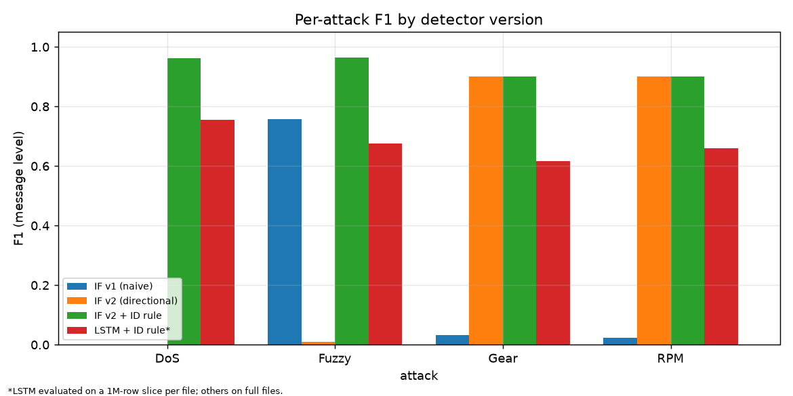

# Automotive IDS: ML anomaly detection on CAN traffic

**Author:** Dhia Benothman

Unsupervised intrusion detection on the HCRL Car-Hacking dataset. All models
train on **normal traffic only** and are evaluated per attack type (DoS, Fuzzy,
Gear spoofing, RPM spoofing).

**Full write-up and threat model:** [`reports/security_report.md`](reports/security_report.md)
**Analysis notebook:** [`notebook/analysis.ipynb`](notebook/analysis.ipynb)

## Results (hybrid detector: ID whitelist + Isolation Forest)

| Attack | Precision | Recall | F1 | FPR |
|---|---|---|---|---|
| DoS | 0.928 | 1.000 | 0.963 | 1.5% |
| Fuzzy | 0.938 | 0.992 | 0.964 | 1.0% |
| Gear spoofing | 0.832 | 0.981 | 0.900 | 3.1% |
| RPM spoofing | 0.829 | 0.989 | 0.902 | 3.4% |

Message-level labels, full attack files. FPR is measured on normal messages
inside attack files; far from any injection it falls to about 0.5%.



## Main findings

- A naive Isolation Forest **failed** (DoS F1 0.0002). It flagged legitimate
  messages delayed by bus contention. Directional per-ID features fixed Gear/RPM (F1 about 0.90).
- DoS and Fuzzy are largely solved by an ID whitelist **because the dataset's
  attackers use IDs never seen in normal traffic**. This is a dataset property, not a general result.
- An LSTM next-ID predictor **underperformed** the forest hybrid on every attack (documented as a negative result).

See the report for limitations (payload not modelled, rate-matched spoofing
untested, feature design informed by attack-file diagnostics).

## Reproduce

```bash
python3 -m venv .venv && source .venv/bin/activate
pip install -r requirements.txt
```

1. **Get the data** (not included in this repo): download the Car-Hacking
   dataset from the HCRL page
   (https://sites.google.com/hksecurity.net/hcrl/Datasets/car-hacking-dataset)
   and place `DoS_dataset.csv`, `Fuzzy_dataset.csv`, `gear_dataset.csv`,
   `RPM_dataset.csv`, `normal_run_data.txt` in `data/raw/`.
2. Run the pipeline in order:

```bash
python src/load_data.py          # CSV/TXT -> parquet (chunked, low memory)
python src/features.py           # causal features
python src/train_iforest.py      # v1 baseline
python src/train_iforest_v2.py   # directional per-ID features
python src/eval_hybrid.py        # whitelist + forest ablation
python src/train_lstm.py         # LSTM (CPU: about 10 min)
python src/compare_lstm.py
python src/fpr_by_distance.py
python src/make_figures.py
```

Seed 42 throughout. About 8 GB RAM recommended. Models and processed data are git-ignored.

## Citation

This project uses the HCRL Car-Hacking dataset (Hacking and Countermeasure
Research Lab, Korea University), as its authors request, please cite:

- Song, H. M., Woo, J., & Kim, H. K. (2020). In-vehicle network intrusion
  detection using deep convolutional neural network. *Vehicular
  Communications*, 21, 100198.
- Seo, E., Song, H. M., & Kim, H. K. (2018). GIDS: GAN based Intrusion
  Detection System for In-Vehicle Network. *2018 16th Annual Conference on
  Privacy, Security and Trust (PST)*. IEEE.

The dataset is not redistributed here; download it from the HCRL page linked above.

## License

Code: MIT (see `LICENSE`). The dataset is not covered by this license; see the HCRL page for its terms.
